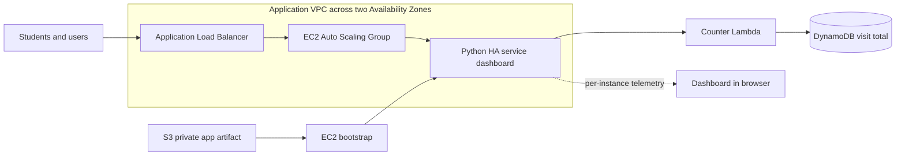

# AWS Highly Available Service Dashboard

This project deploys a live service dashboard to EC2 instances across two AWS Availability Zones. An internet-facing Application Load Balancer distributes requests across an EC2 Auto Scaling group. The dashboard reports a persistent global visit total alongside which instance and Availability Zone answered its latest status request, that instance's uptime, build version, and local page-request count.

The complete infrastructure is managed with Terraform. Deploy the stack from the repository root with `./deploy.sh`.

## Architecture



Terraform creates a VPC with two public subnets, an Internet Gateway, route table, security groups, an ALB, and an Auto Scaling group. The group starts with two instances, scales between two and four instances using a 60% average CPU target, and uses ALB health checks to replace unhealthy instances. EC2 receives SSM access, permission to invoke only the visitor-counter Lambda, and permission to download only the deployed app object from S3. Lambda atomically increments the persistent visit total in DynamoDB.

Terraform packages the web app as a ZIP containing the Python server and dashboard assets, then uploads it to a private, encrypted S3 bucket. EC2 user data downloads the artifact at startup rather than embedding application source in the launch template. The app bundle hash is displayed as the build version and changing the bundle triggers an Auto Scaling instance refresh.

## Project structure

```text
aws-highly-available-webapp/
├── app/
│   ├── server.py
│   ├── dashboard.css
│   ├── dashboard.js
│   ├── requirements.txt
│   └── test_server.py
├── terraform/
│   ├── lambda/
│   │   └── index.py
│   ├── main.tf
│   ├── outputs.tf
│   ├── user_data.sh.tftpl
│   ├── variables.tf
│   └── versions.tf
├── scripts/
│   ├── cleanup.sh
│   ├── deploy.sh
│   └── test.sh
└── deploy.sh
```

## Prerequisites

- Terraform 1.5 or later
- AWS CLI configured with credentials for the target account
- AWS permissions to create VPC/networking, EC2/Auto Scaling, ELB, S3, Lambda, DynamoDB, IAM, and SSM-related resources
- `curl` to run the application smoke test

Terraform uses the local state file at `terraform/terraform.tfstate` by default. Keep state private and back it up; it can contain infrastructure metadata. For team or production use, configure a remote, encrypted Terraform backend with locking before deployment.

If you previously ran Terraform from the old `infra/` directory, move its state and backup into `terraform/` before running the deployment script. Do not apply from the new directory until existing state has been migrated, or Terraform may try to create a second stack.

## Configure and deploy

By default, the project deploys to `us-east-1` with the stack name `aws-capstone`. You can override either value:

```bash
export AWS_REGION=us-east-1
export STACK_NAME=aws-capstone
```

Deploy the complete stack with one command from the repository root:

```bash
./deploy.sh
```

This initializes Terraform, provisions the AWS infrastructure, launches the dashboard, and prints outputs including the website URL. AWS credentials must already be configured. The stack creates public subnets and allows public HTTP traffic to the ALB; it is a teaching example, not a production-ready security design.

For manual Terraform operations:

```bash
terraform -chdir=terraform init
terraform -chdir=terraform fmt -check
terraform -chdir=terraform validate
terraform -chdir=terraform plan \
  -var="aws_region=${AWS_REGION:-us-east-1}" \
  -var="project_name=${STACK_NAME:-aws-capstone}"
terraform -chdir=terraform apply \
  -var="aws_region=${AWS_REGION:-us-east-1}" \
  -var="project_name=${STACK_NAME:-aws-capstone}"
```

Terraform outputs include the website URL, ALB DNS name, Auto Scaling group name, visitor-counter DynamoDB table and Lambda names, and app bundle hash.

> **Migrating from CloudFormation:** Terraform does not automatically adopt resources from a CloudFormation stack. Do not deploy this configuration over a live CloudFormation deployment with the same resource names. First plan a migration: either use a new stack name to create a parallel stack, or explicitly migrate/import resources and state. Deleting the old CloudFormation stack destroys its resources.

## Dashboard and classroom demo

Open the `website_url` output. The dashboard shows a persistent global page-visit total, incremented once whenever the homepage is requested and stored atomically in DynamoDB. `/api/status` polls every five seconds to show the instance that answered the latest status request, its Availability Zone and region, uptime, build version, and page requests served by that instance. The request count is per-instance, not a cluster-wide total. Status polling does not increment the global visit total. Reloading or polling through the ALB may reveal another instance; ALB routing is not guaranteed to alternate requests evenly.

For a recovery demonstration:

1. Keep the dashboard open and note the responding instance and zone.
2. Refresh the status observation and compare the instance metadata returned through the ALB.
3. In the EC2 console, terminate one instance belonging to this Auto Scaling group.
4. Watch the ALB stop routing to the unhealthy target, then watch Auto Scaling launch a replacement and the dashboard return to healthy responses.

The dashboard does not query AWS control-plane health or claim to show a count of healthy instances. Use the EC2 Auto Scaling and Target Groups consoles to observe those states directly.

## Test

Run the live smoke test after deployment:

```bash
./scripts/test.sh
```

It checks the dashboard page and numeric visitor total, the ALB readiness endpoint, and the instance telemetry API. Run the local application unit tests with Python's standard library; AWS credentials are not required:

```bash
python3 -m unittest discover -s app -p 'test_*.py' -v
```

## Application patterns for students

- **Configuration and startup:** host, port, region, and app version are configured through environment variables. Invalid ports stop startup with a clear error, and importing the module does not start the server.
- **Health and routing:** `/health` provides a lightweight liveness check and `/health/ready` is the ALB target health check. Neither changes dashboard metrics. `GET /` increments the global DynamoDB total once and the answering instance's in-memory page count.
- **Counter resilience:** page rendering continues if the counter cannot be reached; the dashboard shows an unavailable message and the service logs a structured counter error. Lambda uses DynamoDB's atomic `ADD` update so simultaneous visits are not lost.
- **Instance metadata:** the server uses IMDSv2 for the EC2 instance ID, Availability Zone, and region. When metadata is unavailable, such as during local development, it reports `local`.
- **Concurrency and observability:** a threaded HTTP server uses a lock for request counters, adds a per-request ID, and writes structured JSON logs to stdout. On EC2, inspect service logs with `sudo journalctl -u capstone`.
- **Security:** responses include browser security headers and a restrictive same-origin content security policy. The dashboard inserts API values as text rather than HTML.
- **Background video:** the index page uses a muted CC0 video hosted by MDN's interactive examples. A dark overlay preserves text contrast, the existing gradient remains as a fallback, and playback is disabled when the browser requests reduced motion. The CSP allows media only from that video host.
- **Deployment:** the app ZIP is stored in a private S3 bucket; the EC2 instance role has read access scoped to that artifact.

This is a teaching example, not a claim that the whole deployment is production-ready. It uses public HTTP and public subnets, does not ship application logs to CloudWatch, and the dashboard's per-instance request counts reset when an instance is replaced. The DynamoDB-backed global visit count persists across instance replacement.

## Clean up

Destroy the resources managed by the current Terraform state:

```bash
./scripts/cleanup.sh
```

Or run Terraform directly:

```bash
terraform -chdir=terraform destroy \
  -var="aws_region=${AWS_REGION:-us-east-1}" \
  -var="project_name=${STACK_NAME:-aws-capstone}"
```

The cleanup script uses Terraform's current state and configured stack name and region. Keep the state file until destroy completes successfully.

## Security and operational considerations

- The ALB accepts HTTP on port 80 from the internet; add ACM, HTTPS, and a custom domain for production.
- The instances are in public subnets, although the web security group accepts application traffic only from the ALB.
- The application artifact is stored in a private S3 bucket with public access blocked and server-side encryption enabled; EC2 can read only the deployed app object.
- EC2 bootstrap installs Python dependencies from the package index at instance startup.
- Add monitoring, alarms, WAF, private subnets, egress controls, and a remote Terraform backend before production use.
- The DynamoDB counter table uses on-demand billing and is removed when the Terraform stack is destroyed.

## References

- [Architecture diagram](./architecture.svg)
- [AWS EC2 Auto Scaling documentation](https://docs.aws.amazon.com/autoscaling/ec2/userguide/what-is-amazon-ec2-auto-scaling.html)
- [AWS Elastic Load Balancing documentation](https://docs.aws.amazon.com/elasticloadbalancing/)
- [AWS Lambda documentation](https://docs.aws.amazon.com/lambda/)
- [Amazon DynamoDB documentation](https://docs.aws.amazon.com/dynamodb/)
- [Terraform AWS provider documentation](https://registry.terraform.io/providers/hashicorp/aws/latest/docs)
