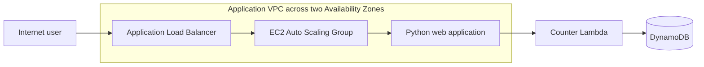

# AWS Highly Available Web Application with Visitor Counter

This project deploys a Python web application on EC2 instances in two Availability Zones. An internet-facing Application Load Balancer distributes HTTP traffic across the instances. Each page request invokes a Lambda function that atomically increments a visitor count in DynamoDB.

The complete infrastructure is managed with Terraform.

## Architecture



The stack creates a VPC with two public subnets, an Internet Gateway, route table, security groups, and an ALB. The Auto Scaling group starts with two instances and scales between two and four instances using a 60% average CPU target. EC2 instances receive an IAM instance profile with SSM access and permission to invoke only the counter Lambda function.

## Project structure

```text
aws-highly-available-webapp/
├── app/
│   └── server.py
├── infra/
│   ├── lambda/
│   │   └── index.py
│   ├── main.tf
│   ├── outputs.tf
│   ├── user_data.sh.tftpl
│   ├── variables.tf
│   └── versions.tf
└── scripts/
    ├── cleanup.sh
    ├── deploy.sh
    └── test.sh
```

## Prerequisites

- Terraform 1.5 or later
- AWS CLI configured with credentials for the target account
- AWS permissions to create VPC/networking, EC2/Auto Scaling, ELB, Lambda, DynamoDB, IAM, and SSM-related resources
- `curl` to run the application smoke test

Terraform uses the local state file at `infra/terraform.tfstate` by default. Keep state private and back it up; it can contain infrastructure metadata. For team or production use, configure a remote, encrypted Terraform backend with locking before deployment.

## Configure

The defaults deploy to `us-east-1` with two `t3.micro` instances, matching the original capstone stack. Override the region and stack name using environment variables:

```bash
export AWS_REGION=us-east-1
export STACK_NAME=aws-capstone
```

The corresponding Terraform inputs are in [infra/variables.tf](./infra/variables.tf). The stack creates public subnets and allows public HTTP traffic to the load balancer; it is intended as a learning example, not a production-ready security design.

## Deploy

The helper script initializes Terraform, creates or updates the infrastructure, and prints its outputs:

```bash
./scripts/deploy.sh
```

Or run Terraform directly from the repository root:

```bash
terraform -chdir=infra init
terraform -chdir=infra fmt -check
terraform -chdir=infra validate
terraform -chdir=infra plan \
  -var="aws_region=${AWS_REGION:-us-east-1}" \
  -var="project_name=${STACK_NAME:-aws-capstone}"
terraform -chdir=infra apply \
  -var="aws_region=${AWS_REGION:-us-east-1}" \
  -var="project_name=${STACK_NAME:-aws-capstone}"
```

Terraform outputs include the website URL, ALB DNS name, DynamoDB table name, Lambda function name, and Auto Scaling group name. Open the `website_url` output in a browser; refreshing the page increments the visitor count.

> **Migrating from CloudFormation:** Terraform does not automatically adopt resources from an existing CloudFormation stack. Do not deploy this configuration over a live CloudFormation deployment with the same resource names. First plan a migration: either use a new `STACK_NAME` to create a parallel Terraform stack, or explicitly migrate/import resources and state. Deleting the old CloudFormation stack destroys its resources and data.

## Test

Run the smoke test to request the website and read the visitor item from DynamoDB:

```bash
./scripts/test.sh
```

The test reads `website_url` and `dynamodb_table_name` from the active Terraform state. You can inspect all outputs directly:

```bash
terraform -chdir=infra output
```

## Clean up

Destroy the resources managed by the current Terraform state:

```bash
./scripts/cleanup.sh
```

Or run Terraform directly:

```bash
terraform -chdir=infra destroy \
  -var="aws_region=${AWS_REGION:-us-east-1}" \
  -var="project_name=${STACK_NAME:-aws-capstone}"
```

The cleanup script uses Terraform's current state and the configured stack name and region. Keep the state file until the destroy completes successfully.

## Security and operational considerations

- The ALB accepts HTTP on port 80 from the internet; add ACM, HTTPS, and a custom domain for production.
- The instances are in public subnets, although the web security group accepts application traffic only from the ALB.
- EC2 bootstrap installs `boto3` from the package index at instance startup.
- Add monitoring, alarms, WAF, private subnets, egress controls, and a remote Terraform backend before production use.
- The DynamoDB table uses on-demand billing and is removed when the Terraform stack is destroyed.

## References

- [Architecture diagram](./architecture.svg)
- [AWS EC2 Auto Scaling documentation](https://docs.aws.amazon.com/autoscaling/ec2/userguide/what-is-amazon-ec2-auto-scaling.html)
- [AWS Elastic Load Balancing documentation](https://docs.aws.amazon.com/elasticloadbalancing/)
- [AWS Lambda documentation](https://docs.aws.amazon.com/lambda/)
- [Amazon DynamoDB documentation](https://docs.aws.amazon.com/dynamodb/)
- [Terraform AWS provider documentation](https://registry.terraform.io/providers/hashicorp/aws/latest/docs)
