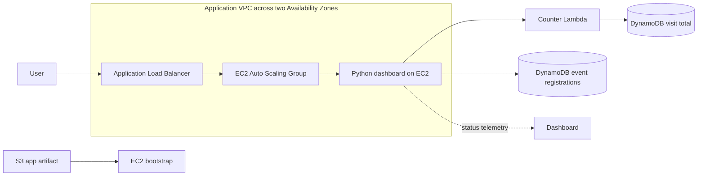
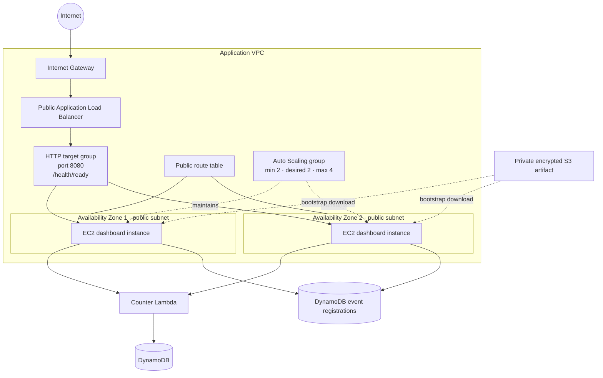
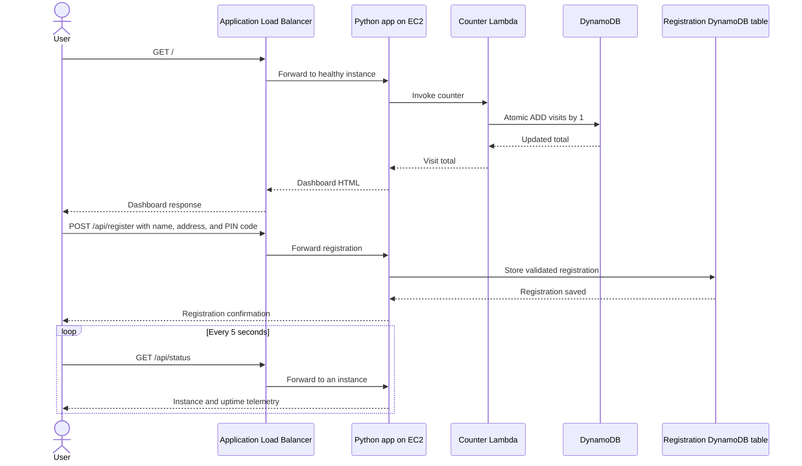
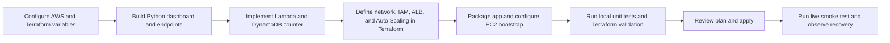

# Flipkart Mobile Launch Event

## Objectives
- Deploy a web application across two AWS Availability Zones.
- Distribute HTTP requests and replace unhealthy application instances.
- Host a midnight mobile-sale event page with customer registration.
- Demonstrate horizontal scaling, health checks, instance telemetry, and persistent event registrations.
- Provision and manage the infrastructure as code with Terraform.

**Remember:** This is an educational high-availability demonstration, not a production security baseline.

## Application

The Python web app serves a Flipkart Mobile Launch Event page with a countdown to the next local midnight and a registration form for customer name, address, and a six-digit Indian PIN code. Registration details are stored in a dedicated DynamoDB table. The page also displays a global visit total stored in DynamoDB and incremented through Lambda, and compact application/instance status.

| Route | Purpose |
|---|---|
| `/` | Serves the event page and increments the global visit total once per page request. |
| `POST /api/register` | Validates name, address, and PIN code, then stores the registration in DynamoDB. |
| `/api/status` | Returns instance telemetry; dashboard polling does not change visit totals. |
| `/health` | Lightweight liveness endpoint. |
| `/health/ready` | Readiness endpoint used by the ALB target health check. |

Registrations and the global visit total persist in their respective DynamoDB tables until the stack is destroyed. Registration data contains personal information; protect access to AWS and Terraform state, and destroy the stack when this event data is no longer needed. The application does not currently enforce an event-specific retention period. Per-instance request counts reset when an instance is replaced. ALB routing does not guarantee that consecutive requests reach different instances.

**Remember:** The event page reports application and instance observations; use AWS console/service tools to inspect control-plane health.

## Architecture



Terraform provisions two public subnets, an Internet Gateway, routing and security groups, an internet-facing ALB, and an EC2 Auto Scaling group. The group defaults to two `t3.micro` instances, can scale from two to four instances, and targets 60% average CPU utilization. ALB health checks use `/health/ready`.

The application and Lambda deployment packages are zipped by Terraform. The app package is stored in a private, AES-256 server-side-encrypted S3 bucket. EC2 user data downloads and installs the app at startup. A changed app bundle hash updates the launch template and triggers a rolling instance refresh.

**Remember:** The ALB accepts public HTTP on port 80; the web instances accept port 8080 only from the ALB security group.

### Network and deployment topology



The two subnet and instance groups represent the multi-AZ layout. The ALB security group allows inbound HTTP from the internet; the instance security group allows application traffic only from the ALB. EC2 uses its IAM instance profile for S3, Lambda, DynamoDB registrations, and Systems Manager access.

### Page, counter, and registration flow



If the counter call fails, the app still serves the event page with an unavailable counter message. Registration submission reports a failure if DynamoDB cannot save the details. The per-instance request count and uptime are in-memory telemetry; registrations and the visit total are shared and persistent.

### Implementation workflow



**Remember:** The diagrams describe the current implementation; planned production enhancements are listed under [Future scope](#future-scope).

## Technical stack details

| Area | Technology and configuration |
|---|---|
| Infrastructure as code | Terraform `>= 1.5.0`; AWS provider `>= 5.0, < 7.0`; Archive provider `>= 2.6, < 3.0`. |
| Compute | Amazon Linux 2023 EC2 instances; default instance type `t3.micro`. |
| Application | Python 3 HTTP server, HTML, CSS, and browser JavaScript. |
| AWS SDK | `boto3 >= 1.34, < 2.0` on EC2. |
| Counter function | AWS Lambda, Python 3.12 runtime. |
| Networking | One VPC with two public subnets in separate Availability Zones. |
| Scaling and routing | Application Load Balancer and EC2 Auto Scaling; CPU target defaults to 60%. |
| State and artifact storage | DynamoDB on-demand counter and registration tables; private S3 app artifact bucket. |
| Instance access | IAM instance profile with scoped S3/Lambda/DynamoDB permissions and Systems Manager managed-instance permissions. |
| Deployment | Bash scripts invoke Terraform; default Region `us-east-1`, stack name `aws-capstone`. |

**Remember:** AWS credentials must be configured for Terraform's AWS provider. Review the plan, Region, and stack name before applying.

## AWS service significance

| AWS service | How it is used | Significance |
|---|---|---|
| Amazon VPC | Provides the application network, two public subnets, Internet Gateway, routes, and security groups. | Isolates and controls network connectivity for the deployment. |
| Amazon EC2 | Runs the Python event page on Amazon Linux 2023. | Provides the application compute capacity. |
| Elastic Load Balancing (ALB) | Accepts HTTP and forwards requests to healthy targets. | Distributes traffic and removes unhealthy targets from routing. |
| EC2 Auto Scaling | Maintains two to four instances, replaces unhealthy instances, and tracks average CPU. | Supports availability, recovery, and demand-based capacity. |
| Amazon S3 | Holds the zipped application artifact with public access blocked and encryption enabled. | Separates application packaging from instance bootstrapping. |
| AWS Lambda | Atomically increments the global visit count by calling DynamoDB. | Keeps counter updates independent of individual web instances. |
| Amazon DynamoDB | Stores the shared visit total and customer event registrations with on-demand billing. | Retains data across instance replacements. Registration writes are limited to the registration table by the EC2 role. |
| AWS Identity and Access Management (IAM) | Grants EC2 and Lambda narrowly scoped service permissions. | Enables service-to-service access without application-stored AWS keys. |
| AWS Systems Manager | EC2 instance role includes `AmazonSSMManagedInstanceCore`. | Supports managed-instance access without requiring inbound SSH access. |

**Remember:** Terraform manages these resources from the current state; do not point this configuration at an unrelated or production state.

## Project structure

```text
aws-highly-available-webapp/
├── app/                     # Python server, dashboard assets, and unit tests
├── scripts/                 # Deploy, cleanup, and live smoke-test scripts
├── terraform/               # AWS resources, Lambda source, and EC2 user data
├── cleanup.sh               # Root-level cleanup entry point
└── deploy.sh                # Root-level deployment entry point
```

**Remember:** Application code, infrastructure definitions, and operational scripts are kept in separate directories.

## Steps to implement the project

1. **Prepare the environment.** Install Terraform 1.5 or later, configure AWS credentials, and confirm the selected account and Region. Ensure the account can create the VPC, EC2, load-balancing, Auto Scaling, S3, Lambda, DynamoDB, IAM, and Systems Manager resources used here.
2. **Set deployment parameters.** Optionally set `AWS_REGION` and `STACK_NAME`. Defaults are `us-east-1` and `aws-capstone`; see [Terraform variables](./terraform/variables.tf) for instance type, subnet CIDRs, scaling bounds, and CPU target.
3. **Implement the application.** Use [app/server.py](./app/server.py) for the Python HTTP server and routes, [app/dashboard.js](./app/dashboard.js) and [app/dashboard.css](./app/dashboard.css) for the dashboard, and [app/test_server.py](./app/test_server.py) for local behavior tests.
4. **Implement the shared counter.** The handler in [terraform/lambda/index.py](./terraform/lambda/index.py) increments the DynamoDB item atomically. Terraform supplies Lambda's table configuration and narrowly scoped IAM permissions.
5. **Define the infrastructure and bootstrap.** Update [terraform/main.tf](./terraform/main.tf) and related Terraform files for networking, IAM, artifact packaging, the ALB, Auto Scaling, and counter resources. [terraform/user_data.sh.tftpl](./terraform/user_data.sh.tftpl) installs the app on EC2 and starts it as a systemd service.
6. **Test before deployment.** Run the local Python unit tests, then check formatting and validate the Terraform configuration:

   ```bash
   python3 -m unittest discover -s app -p 'test_*.py' -v
   terraform -chdir=terraform init
   terraform -chdir=terraform fmt -check
   terraform -chdir=terraform validate
   ```

7. **Review and deploy.** Review a plan for the correct account, Region, and resources, then deploy from the repository root:

   ```bash
   terraform -chdir=terraform plan \
     -var="aws_region=${AWS_REGION:-us-east-1}" \
     -var="project_name=${STACK_NAME:-aws-capstone}"
   ./deploy.sh
   ```

   The deploy script initializes Terraform, applies the configuration, and prints the event page URL.
8. **Verify the running stack.** Open the `website_url` output, run `./scripts/test.sh`, and observe `/api/status`. For a recovery demonstration, terminate one Auto Scaling group instance in the EC2 console and observe target health and replacement in the Auto Scaling and Target Groups consoles.
9. **Clean up when finished.** Run `./cleanup.sh` only when you intend to destroy resources managed by the current state. Preserve the state file until Terraform confirms destroy succeeded.

**Remember:** The deploy and cleanup scripts automatically apply/destroy without an interactive Terraform approval prompt. Inspect the plan and verify the target AWS account before deployment; cleanup is destructive.

## Deploy, test, and clean up

Prerequisites: Terraform 1.5 or later, valid AWS credentials and permissions for the resources listed above, and `curl` for the live smoke test. The AWS CLI is useful but is not required by the scripts if credentials are otherwise configured.

Optional configuration:

```bash
export AWS_REGION=us-east-1
export STACK_NAME=aws-capstone
```

Deploy from the repository root:

```bash
./deploy.sh
```

The script initializes Terraform, applies the configuration, and prints outputs including `website_url`. The local Terraform state is stored under `terraform/terraform.tfstate` by default. Keep it private and back it up securely; state can contain infrastructure metadata. For team or production use, configure a remote encrypted backend with state locking.

Run tests:

```bash
# Local application unit tests; no AWS credentials required
python3 -m unittest discover -s app -p 'test_*.py' -v

# Live smoke test after deployment
./scripts/test.sh
```

Destroy resources tracked by the current Terraform state:

```bash
./cleanup.sh
```

The cleanup script runs `terraform destroy -auto-approve`. Review the selected AWS credentials, Region, stack name, and Terraform state before running it. Keep the state file until destroy completes successfully. The DynamoDB counter and S3 artifact bucket are removed with the stack.

**Remember:** Do not deploy from a new or empty state if this infrastructure already exists; Terraform may create a second stack. Migrate any previous state before applying.

## Future scope

- Add HTTPS with ACM and a custom domain; restrict public access as appropriate.
- Move EC2 instances into private subnets and design controlled outbound access.
- Add CloudWatch application logs, dashboards, alarms, and operational alerts.
- Configure a remote encrypted Terraform backend with locking and a recovery process.
- Add CI/CD with automated tests, plan review, and controlled deployment.
- Evaluate DynamoDB backup/PITR and multi-Region recovery requirements.

**Remember:** Prioritize TLS, network exposure, state protection, monitoring, and recovery before production use.

## Points to remember

- Two Availability Zones improve resilience, but the current application endpoint is public HTTP.
- The global visit count and event registrations are DynamoDB-backed; instance telemetry is local to each EC2 instance.
- ALB health checks use `/health/ready`; the dashboard is not an AWS control-plane health monitor.
- Terraform state is essential for safe updates and cleanup; protect it and preserve it through destroy.
- Cleanup permanently destroys the stack resources, stored counter, and event registrations.

## References

- [Project architecture diagram](./architecture.svg)
- [Amazon VPC documentation](https://docs.aws.amazon.com/vpc/latest/userguide/what-is-amazon-vpc.html)
- [Amazon EC2 Auto Scaling documentation](https://docs.aws.amazon.com/autoscaling/ec2/userguide/what-is-amazon-ec2-auto-scaling.html)
- [Elastic Load Balancing documentation](https://docs.aws.amazon.com/elasticloadbalancing/)
- [Amazon EC2 documentation](https://docs.aws.amazon.com/ec2/)
- [Amazon S3 documentation](https://docs.aws.amazon.com/s3/)
- [AWS Lambda documentation](https://docs.aws.amazon.com/lambda/)
- [Amazon DynamoDB documentation](https://docs.aws.amazon.com/dynamodb/)
- [AWS Identity and Access Management documentation](https://docs.aws.amazon.com/iam/)
- [AWS Systems Manager documentation](https://docs.aws.amazon.com/systems-manager/)
- [Terraform AWS provider documentation](https://registry.terraform.io/providers/hashicorp/aws/latest/docs)

**Remember:** Consult the official service documentation for current limits, pricing, and regional availability.
