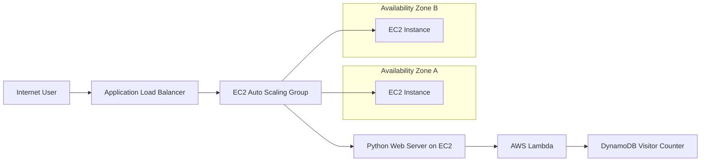

# AWS Highly Available Web Application with Visitor Counter

## 1. Title

AWS Highly Available Web Application with Visitor Counter and Serverless Tracking

This project demonstrates how to design and deploy a resilient application on AWS using a public-facing Application Load Balancer, EC2 instances in multiple Availability Zones, Lambda-based serverless logic, and DynamoDB for tracking page visits. The solution is provisioned through AWS CloudFormation and is intended as a practical cloud architecture and DevOps learning project.

## 2. Objectives

The main objectives of this project are:

- Build a highly available AWS-based web application architecture.
- Deploy web servers in multiple Availability Zones behind a load balancer.
- Use Auto Scaling to handle traffic changes automatically.
- Trigger serverless logic from the application to count visitors.
- Store counter data in DynamoDB with an atomic update pattern.
- Provision infrastructure with Infrastructure as Code using CloudFormation.
- Validate deployment using health checks and sample requests.
- Extend the solution with future production-grade security and monitoring features.

## 3. Project Overview

The application exposes a simple website hosted by EC2 instances. Each request invokes an AWS Lambda function that updates a visitor counter value in DynamoDB. The Application Load Balancer distributes traffic across healthy EC2 instances across two Availability Zones, giving the project a highly available front-end layer.

The current implementation is intentionally simplified for a classroom or capstone environment. It focuses on core AWS services and architecture patterns rather than implementing a full production security stack.

## 4. Future Scope

This project can be extended into a more enterprise-ready production system. Recommended future enhancements include:

- Move EC2 instances into private subnets and add NAT Gateway / VPC endpoints.
- Add Route 53 and ACM for custom domain and HTTPS support.
- Store data in RDS MySQL for relational application use cases.
- Store static content in Amazon S3 with secure access controls.
- Add CloudWatch dashboards, alarms, and SNS notifications.
- Enable CloudTrail and centralized auditing.
- Add WAF protection and security group hardening.
- Implement CI/CD pipelines for automated deployments.
- Add monitoring for latency, error rates, and cost optimization.

## 5. Architecture Diagram

The project architecture is represented in the repository diagram: [architecture.svg](./architecture.svg).



This simplified design emphasizes:

- internet-facing ALB for request distribution,
- EC2 instances running the web application,
- serverless Lambda for incrementing the visitor count,
- DynamoDB as the storage layer,
- Auto Scaling for resilience and traffic handling.

## 6. AWS Services Used

| AWS Service | Purpose |
| --- | --- |
| VPC | Creates isolated network boundaries for resources |
| EC2 | Hosts the web application |
| Application Load Balancer | Balances traffic across multiple EC2 instances |
| Auto Scaling Group | Maintains capacity and availability |
| Lambda | Runs serverless visitor-tracking logic |
| DynamoDB | Stores page visit counts |
| IAM | Provides least-privilege access |
| CloudFormation | Provisions the architecture as code |
| Amazon SSM Parameter Store | Supplies the Linux AMI in the template |

## 7. Project Structure

```text
aws-highly-available-webapp/
├── README.md
├── LICENSE
├── architecture.svg
├── aws_capstone_full_document.docx
├── app/
│   └── server.py
├── infra/
│   └── template.yaml
└── scripts/
    ├── deploy.sh
    ├── test.sh
    └── cleanup.sh
```

## 8. Core Application Code

The web server in [app/server.py](./app/server.py) responds to HTTP requests and invokes the Lambda counter function. A simplified view of the implementation is shown below:

```python
import os, json, boto3
from http.server import BaseHTTPRequestHandler, ThreadingHTTPServer
from urllib.parse import urlparse

lambda_client = boto3.client('lambda', region_name=os.environ.get('AWS_REGION','us-east-1'))

class Handler(BaseHTTPRequestHandler):
    def do_GET(self):
        if urlparse(self.path).path == '/health':
            self.send_response(200)
            self.end_headers()
            self.wfile.write(b'ok')
            return

        count = 'unavailable'
        try:
            response = lambda_client.invoke(
                FunctionName=os.environ['COUNTER_FUNCTION'],
                InvocationType='RequestResponse',
                Payload=b'{}'
            )
            result = json.loads(response['Payload'].read())
            count = result.get('count', 'unavailable')
        except Exception as e:
            print('Visitor counter failed:', repr(e), flush=True)

        body = f'''<!doctype html><html>...'''.encode()
        self.send_response(200)
        self.send_header('Content-Type', 'text/html; charset=utf-8')
        self.send_header('Content-Length', str(len(body)))
        self.end_headers()
        self.wfile.write(body)

ThreadingHTTPServer(('0.0.0.0', 8080), Handler).serve_forever()
```

The backend Lambda logic is defined in the CloudFormation stack and performs an atomic `UpdateItem` operation against DynamoDB.

## 9. Infrastructure Code

The Infrastructure as Code definition in [infra/template.yaml](./infra/template.yaml) creates the core networking and application resources. The template provisions:

- VPC and public subnets in two Availability Zones
- Internet Gateway and route table
- Application Load Balancer
- EC2 Launch Template and Auto Scaling Group
- Lambda function and DynamoDB table
- IAM roles and instance profile
- Output values such as the site URL and DynamoDB table name

```yaml
Resources:
  VPC:
    Type: AWS::EC2::VPC
    Properties:
      CidrBlock: 10.20.0.0/16
      EnableDnsHostnames: true
      EnableDnsSupport: true

  ALB:
    Type: AWS::ElasticLoadBalancingV2::LoadBalancer
    Properties:
      Scheme: internet-facing
      Type: application
      SecurityGroups: [!Ref ALBSG]
      Subnets: [!Ref PublicSubnet1, !Ref PublicSubnet2]

  CounterFunction:
    Type: AWS::Lambda::Function
    Properties:
      Runtime: python3.12
      Handler: index.handler
      Role: !GetAtt LambdaRole.Arn
      Environment:
        Variables: {TABLE_NAME: !Ref CounterTable}
```

## 10. Deployment Steps

Follow the steps below to deploy the stack.

### Step 1: Configure AWS credentials

```bash
aws configure
```

Ensure that your user or role has permission to work with CloudFormation, EC2, Lambda, DynamoDB, IAM, and Elastic Load Balancing.

### Step 2: Validate the CloudFormation template

```bash
aws cloudformation validate-template --template-body file://infra/template.yaml --region us-east-1
```

### Step 3: Deploy the infrastructure

```bash
aws cloudformation deploy \
  --stack-name aws-capstone \
  --template-file infra/template.yaml \
  --capabilities CAPABILITY_IAM \
  --region us-east-1
```

### Step 4: Retrieve deployment outputs

```bash
aws cloudformation describe-stacks \
  --stack-name aws-capstone \
  --query 'Stacks[0].Outputs' \
  --region us-east-1
```

### Step 5: Access the application

Open the `WebsiteURL` output in a browser and refresh the page. The visitor count will update as the Lambda function writes to DynamoDB.

### Step 6: Clean up the stack

```bash
aws cloudformation delete-stack --stack-name aws-capstone --region us-east-1
aws cloudformation wait stack-delete-complete --stack-name aws-capstone --region us-east-1
```

## 11. Automation Scripts

The repository includes deployment, validation, and cleanup helper scripts in the [scripts/](./scripts) directory.

### Deploy the project

```bash
./scripts/deploy.sh
```

### Test the application and DynamoDB counter

```bash
./scripts/test.sh
```

### Delete the CloudFormation stack

```bash
./scripts/cleanup.sh
```

Script content includes the same AWS CLI commands shown in the manual steps and is intended to reduce repeated command entry during testing.

## 12. Testing and Verification

After deployment, verify the system works in two ways:

1. Request the website through the ALB URL.
2. Check the DynamoDB counter item to confirm the visitor count increased.

```bash
curl -i "$(aws cloudformation describe-stacks \
  --stack-name aws-capstone \
  --region us-east-1 \
  --query 'Stacks[0].Outputs[?OutputKey==`WebsiteURL`].OutputValue' \
  --output text)"

aws dynamodb get-item \
  --table-name "$(aws cloudformation describe-stacks \
    --stack-name aws-capstone \
    --region us-east-1 \
    --query 'Stacks[0].Outputs[?OutputKey==`DynamoDBTable`].OutputValue' \
    --output text)" \
  --key '{"counter_id":{"S":"homepage"}}' \
  --region us-east-1
```

## 13. Security and Operational Notes

This lab is intentionally simplified and should not be treated as a production-ready environment without additional hardening. The current design uses public subnets for ease of deployment and learning. It is recommended to add the following before using the architecture in a real-world environment:

- HTTPS with ACM and a custom domain
- private subnets and NAT configuration
- WAF protection
- role-scoped IAM policies
- CloudWatch alarm dashboards and SNS notifications
- backup and retention controls for all data stores

## 14. References

- [architecture.svg](./architecture.svg)
- [aws_capstone_full_document.docx](./aws_capstone_full_document.docx)
- AWS CloudFormation User Guide
- AWS EC2 Auto Scaling Documentation
- AWS Elastic Load Balancing Documentation
- AWS Lambda Developer Guide
- Amazon DynamoDB Developer Guide
- AWS Identity and Access Management Documentation

## 15. Conclusion

This project provides a clean introduction to building a highly available AWS application with a serverless data-processing component. It blends foundational cloud services, infrastructure automation, and web application deployment into a single, practical use case suitable for learning, demonstrations, and capstone-style implementation.
